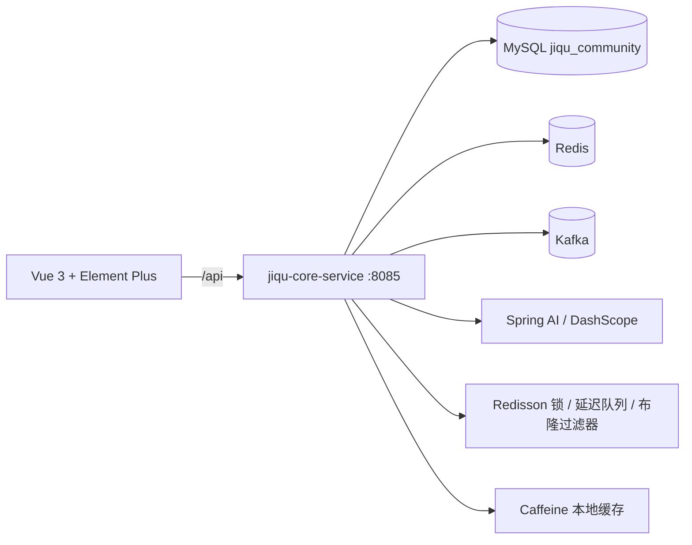

# 集趣 · 潮流社区

一个基于 Spring Boot 3 + Redis + Kafka + Spring AI 的潮流社区与限量发售平台。

## 项目结构

```text
jiqu/
├── jiqu-core-service/             # 核心业务服务（启动模块）
├── jiqu-common/                   # 通用常量、枚举、异常
├── jiqu-parameter/                # DTO / VO
├── jiqu-redisson-framework/       # 分布式锁、布隆过滤器、延迟队列
├── jiqu-redis-tool-framework/     # Redis 缓存封装、滑动窗口/令牌桶限流
├── jiqu-mq-framework/             # Kafka 生产者、消费者封装
├── jiqu-id-generator-framework/   # 雪花 ID 生成
├── jiqu-vue3/                     # Vue 3 + Vite + Element Plus 前端
├── jiqu_community.sql             # 数据库初始化脚本
├── LICENSE
└── pom.xml
```

## 核心接口

| 方法 | 路径 | 说明 |
|---|---|---|
| POST | `/user/code` | 发送手机验证码 |
| POST | `/user/login` | 验证码或密码登录 |
| POST | `/user/logout` | 退出登录并失效令牌 |
| GET | `/user/me` | 当前登录用户 |
| GET | `/user/info/{id}` | 用户详情 |
| GET | `/store/{id}` | 店铺详情 |
| GET | `/store/of/type` | 按分类查询店铺 |
| GET | `/store/of/name` | 按名称搜索店铺 |
| GET | `/store-category/list` | 店铺分类列表 |
| GET | `/drop/list/{storeId}` | 店铺限量发售列表 |
| GET | `/drop/calendar` | 发售日历 |
| POST | `/drop-order/drop/token/{id}` | 获取抢购访问令牌 |
| POST | `/drop-order/drop/{id}` | 限量抢购下单 |
| POST | `/drop-order/cancel` | 取消抢购订单 |
| GET | `/blog/hot` | 热门社区内容 |
| POST | `/blog` | 发布社区内容 |
| PUT | `/blog/like/{id}` | 点赞 |
| GET | `/blog/{id}` | 内容详情 |
| PUT | `/follow/{id}/{isFollow}` | 关注或取关 |
| GET | `/follow/count` | 关注数/粉丝数 |
| POST | `/ai/chat` | AI 智能问答 |
| POST | `/upload/blog` | 上传社区图片 |

## 模块说明

| 模块 | 端口 | 职责 |
|---|---:|---|
| `jiqu-core-service` | 8085 | 启动模块，包含用户、店铺、限量发售、订单、社区、AI 等核心业务 |
| `jiqu-common` | - | 通用常量、枚举、异常、工具类 |
| `jiqu-parameter` | - | DTO、VO 等接口参数 |
| `jiqu-redisson-framework` | - | 分布式锁、布隆过滤器、延迟队列 |
| `jiqu-redis-tool-framework` | - | Redis 缓存封装、滑动窗口与令牌桶限流 |
| `jiqu-mq-framework` | - | Kafka 生产者、消费者、公共封装 |
| `jiqu-id-generator-framework` | - | 雪花 ID 生成 |
| `jiqu-vue3` | 5173 | Vue 3 + Vite + Element Plus 前端 |

## 系统架构



## 技术栈

| 层次 | 技术 |
|---|---|
| 后端 | Java 17、Spring Boot 3.5、MyBatis-Plus |
| 存储 | MySQL 8、Redis |
| 分布式能力 | Redisson、Kafka、Caffeine |
| AI | Spring AI、Spring AI Alibaba、RAG、Function Calling |
| 前端 | Vue 3、Vite、Element Plus、Pinia、Axios |

## 功能特性

- **限量发售**：Redis + Lua 完成库存预扣减与单人限购校验，Redisson 分布式锁保障缓存重建与库存预热，Kafka 异步落库实现削峰填谷。
- **防刷与限流**：用户/IP 双维度限流，支持滑动窗口与令牌桶切换；超限临时封禁；抢购前发放一次性访问令牌，Lua 原子校验并消费。
- **多级缓存**：Caffeine 本地缓存 + Redis 分布式缓存；布隆过滤器与缓存空值抵御穿透；互斥锁 + 双重检测解决缓存击穿。
- **消息可靠性**：Kafka 生产者开启 acks=all、幂等与失败重试，消费者手动提交 offset，并通过订单对账与失败补偿保证最终一致。
- **AI 智能问答**：基于 Spring AI 接入 DashScope qwen-plus，使用向量检索增强（RAG）与 Function Calling 查询店铺、计算距离。
- **潮流社区**：店铺浏览、发售日历、社区晒单、点赞、关注、签到、订阅候补、GEO 附近与延迟提醒。
- **登录鉴权**：验证码登录与密码登录，Redis 存储登录令牌，支持退出登录后即时失效。
- **前端体验**：Vue 3 + Element Plus 实现首页、店铺详情、发售日历、社区、个人中心与 AI 助手页面。
